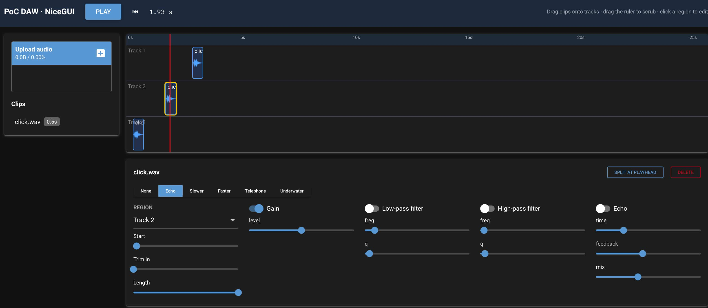

# PoC DAW (NiceGUI)



The same proof-of-concept Digital Audio Workstation as `../Daw`, rebuilt with
[NiceGUI](https://nicegui.io) in place of Django, Datastar, htmx, Tailwind and daisyUI. It exists
to compare the two stacks on identical features.

## Run it

```console
uv sync
uv run python main.py
```

Open http://127.0.0.1:8090. Tests: `uv run pytest`.

## User stories covered

The same stories as the Django version:

1. **Upload a clip.** I can choose an audio file (WAV, MP3, OGG, FLAC…) and it uploads straight away, appearing in my clip library with its duration.
2. **Arrange clips.** I can drag a clip from the library onto one of three tracks at any time position, and drag regions to move them in time or between tracks.
3. **Play the arrangement.** I can press Play to hear every region on every track mixed together, and watch the playhead move. I can press Stop or rewind to the start.
4. **Scrub.** I can drag along the ruler to move the playhead and hear the audio under it as I drag. If playback was running, it resumes from where I let go.
5. **Clip (trim and split).** I can select a region and trim its start (trim in) and its length, or split it in two at the playhead. Each region shows a waveform of the part that will play.
6. **Apply effect plugins.** For a selected region, I can turn on Gain, Low-pass, High-pass and Echo, and adjust each one's parameters.
7. **Pick a filter preset.** I can choose one preset per region with toggle buttons: None, Echo, Slower, Faster, Telephone or Underwater.
8. **Persist.** I can restart the app and find my clips and arrangement as I left them.

## Files

| File | Role | Django equivalent |
|---|---|---|
| `main.py` | The page: header, library, tracks, inspector, all event handlers | templates + `views.py` |
| `store.py` | Clips and regions in `data.json`, with the same clamping, split and speed logic | `models.py` + parts of `views.py` |
| `plugins.py` | Effect plugins and presets (copied unchanged) | `studio/plugins.py` |
| `static/engine.js` | Web Audio engine and `<daw-wave>` waveform component | `studio/static/studio/engine.js` |
| `tests/test_app.py` | Simulated-user tests: upload, drag-drop, move, trim, split, presets, delete | smoke checks via Django's test client |

## How it differs from the Django + Datastar version

- **One language for the whole UI.** Layout, components and event handlers are all Python.
  There are no templates, no HTML attribute expressions and no CSS framework setup. NiceGUI
  ships Quasar (Vue) components and Tailwind classes.
- **State lives on the server, over a WebSocket.** Every click, drop and slider release is
  an event sent to Python, and Python sends back changed components. Datastar sends an HTTP
  request and gets back HTML.
- **Fast-changing state must stay in the browser.** Sending the playhead to the server 60
  times a second over the WebSocket would be wasteful, so here the audio engine moves the
  playhead line, updates the time readout and handles ruler scrubbing directly in the browser.
  Only "playback ended" goes back to Python (`emitEvent('daw-ended')`). In the Datastar version
  these are signals in the page. The audio engine is otherwise the same code.
- **The arrangement is pushed to the browser.** Python calls `daw.setArrangement(...)` after each
  change, instead of rendering a JSON script tag for the engine to read.
- **Simulated-user tests.** NiceGUI's `User` fixture drives the real page logic (finding
  elements, triggering drag events, faking JS results) without a browser. That covers much
  more of the UI than was testable in the Django version.
- **Single process, single user.** NiceGUI runs its own server. Data is a JSON file rather
  than a database. Each browser tab gets its own UI state (selection, play state), but everyone
  edits the same arrangement.

### Pitfalls found while building it

- **Use the page's client to run JavaScript.** Many handlers refresh the very element that
  triggered them, for example dropping onto a track that then gets redrawn. After that,
  `ui.run_javascript()` can no longer find the client and raises an error. The app holds on to
  `client = ui.context.client` when the page is built and calls `client.run_javascript()`. The
  tests caught this.
- **`refresh()` happens in the background.** In NiceGUI 3.18, `refreshable.refresh()` schedules
  the rebuild as a background task unless awaited, so code (or tests) running straight after
  still sees the old elements.
- **Sliders send updates only on release.** They listen to Quasar's `change` event, so dragging
  a slider doesn't flood the server and restart audio on every pixel.

## Not tested

Browser-side behaviour (audio playback, scrubbing, waveform drawing, real drag-and-drop in a
browser) hasn't been tested. The simulated-user tests call the Python handlers directly, with
the JavaScript side faked.
